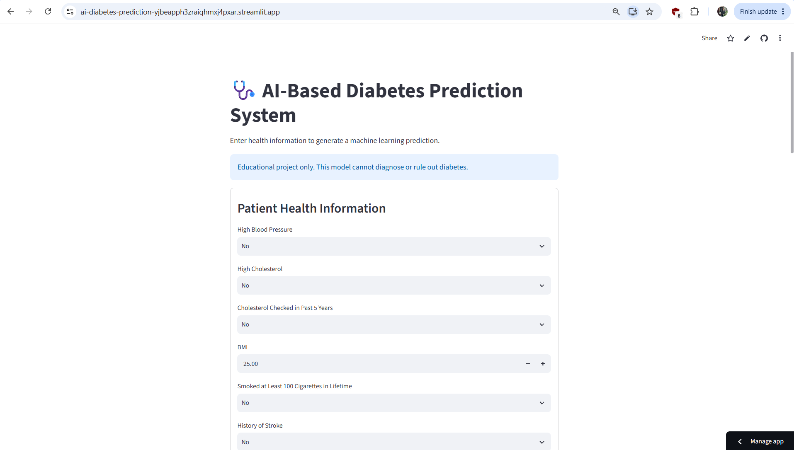
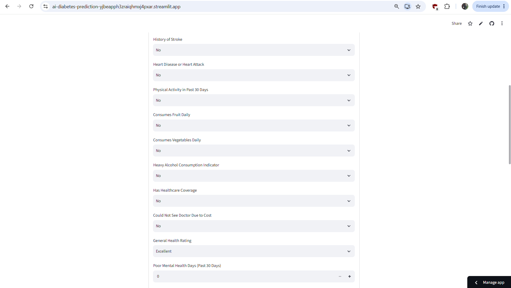
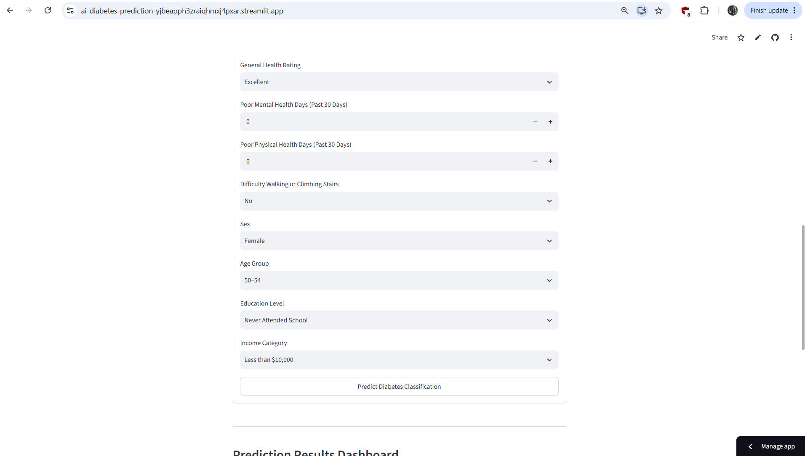
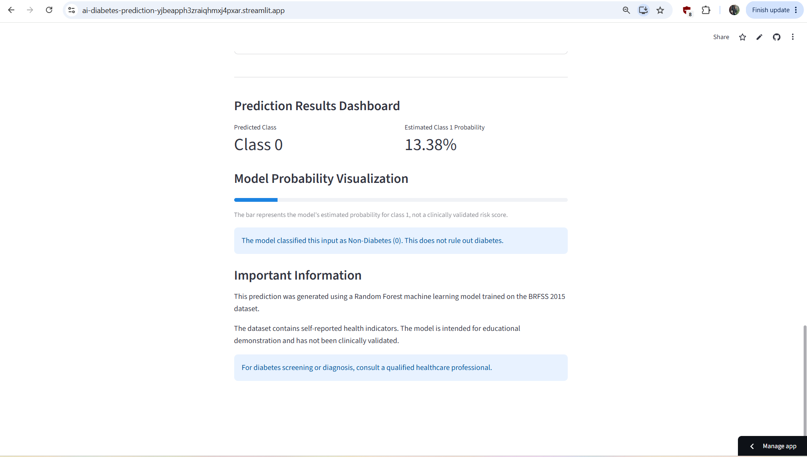

# AI-Based Diabetes Prediction System

## Live Application

[Click Here to Open the AI Diabetes Prediction App](https://ai-diabetes-prediction-yibeaph3zraighmxj4pxar.streamlit.app)

This application demonstrates diabetes classification using a Random Forest machine learning model.

**Disclaimer:** Educational use only. Not a medical diagnostic tool.

## Project Overview

An end-to-end machine learning project that explores
health survey data and predicts diabetes classification
using a trained classification model.

The project includes exploratory data analysis,
data preprocessing, machine learning, model evaluation,
and an interactive Streamlit web application.

**Disclaimer:** This is an educational machine learning
project. It is not a medical diagnostic tool.

## Dataset

Source: Diabetes Health Indicators Dataset
(BRFSS 2015)

The dataset contains survey-based health indicators
including:

- High blood pressure
- High cholesterol
- BMI
- Smoking history
- Physical activity
- General health
- Age category
- Education and income

## Technologies Used

- Python
- Pandas
- NumPy
- Matplotlib
- Seaborn
- Scikit-learn
- Jupyter Notebook
- Streamlit
- Joblib

## Project Workflow

1. Dataset loading and exploration
2. Data cleaning and preprocessing
3. Exploratory data analysis (EDA)
4. Feature and target selection
5. Training and testing split
6. Machine learning model training
7. Model performance evaluation
8. Saving the trained model
9. Building the Streamlit application

## Model Evaluation

The notebook evaluates classification performance
using metrics and visualizations.

Actual performance scores should be taken from
the executed Jupyter Notebook.

## Streamlit Application

The application allows users to:

- Enter health-related information
- Select categorical health indicators
- Generate a model classification
- View the estimated probability for class 1

The displayed probability is a model output,
not a clinically validated diabetes risk score.

## Run Locally

Install the required packages:

```bash
pip install -r requirements.txt
```

Start the Streamlit application:

```bash
streamlit run app.py
```

## Project Limitations

- Uses historical BRFSS 2015 survey data
- Model predictions may contain errors
- Survey data may contain reporting bias
- The model has not been clinically validated
- Predictions must not replace medical advice

## Future Improvements

- Compare additional classification algorithms
- Improve probability calibration
- Add explainable AI visualizations
- Improve the Streamlit interface
- Deploy the application online

## Author

Ditya Gupta

Interested in Data Analytics, Python,
Machine Learning, and Data Visualization.


## Technology Stack

| Technology | Purpose |
|------------|---------|
| Python | Core programming language |
| Pandas | Data cleaning and manipulation |
| NumPy | Numerical operations |
| Matplotlib | Data visualization |
| Seaborn | Exploratory data analysis |
| Scikit-learn | Machine learning and model evaluation |
| Random Forest | Diabetes classification model |
| Joblib | Model serialization |
| Streamlit | Interactive web application |
| Git & GitHub | Version control and project hosting |
| Git LFS | Storage of large trained model files |

## Key Features

- Exploratory data analysis of BRFSS 2015 health survey data
- Data preprocessing and missing-value handling
- Random Forest classification model
- Interactive form with 21 health indicators
- Model prediction and estimated class probability
- Visual prediction results dashboard
- Publicly deployed Streamlit web application

**Important:** This project is an educational machine learning demonstration, not a clinically validated diabetes screening or diagnostic tool.

## Model Performance

The Random Forest classifier was evaluated on a test set of
50,736 samples from the BRFSS 2015 dataset.

### Evaluation Metrics

| Metric | Score |
|--------|-------|
| Accuracy | 75.54% |
| Precision (Class 1) | 32.77% |
| Recall (Class 1) | 71.85% |
| F1-Score (Class 1) | 45.01% |

### Classification Report

| Class | Precision | Recall | F1-Score | Support |
|-------|-----------|--------|----------|---------|
| Non-Diabetes (0) | 0.94 | 0.76 | 0.84 | 43,667 |
| Diabetes (1) | 0.33 | 0.72 | 0.45 | 7,069 |

### Model Interpretation

The Random Forest model achieved an overall accuracy
of 75.54% on the test dataset.

For Class 1, recall was approximately 71.85%, while
precision was approximately 32.77%.

This indicates that the model identifies a substantial
proportion of actual Class 1 cases but also produces
many false-positive classifications.

These results are specific to the evaluation dataset


## Application Screenshots

### 1. Application Interface


### 2. Health Indicators


### 3. Prediction Form


### 4. Prediction Results Dashboard


and do not establish clinical reliability.

**Disclaimer:** This model is an educational demonstration
and must not be used for medical diagnosis or screening.

